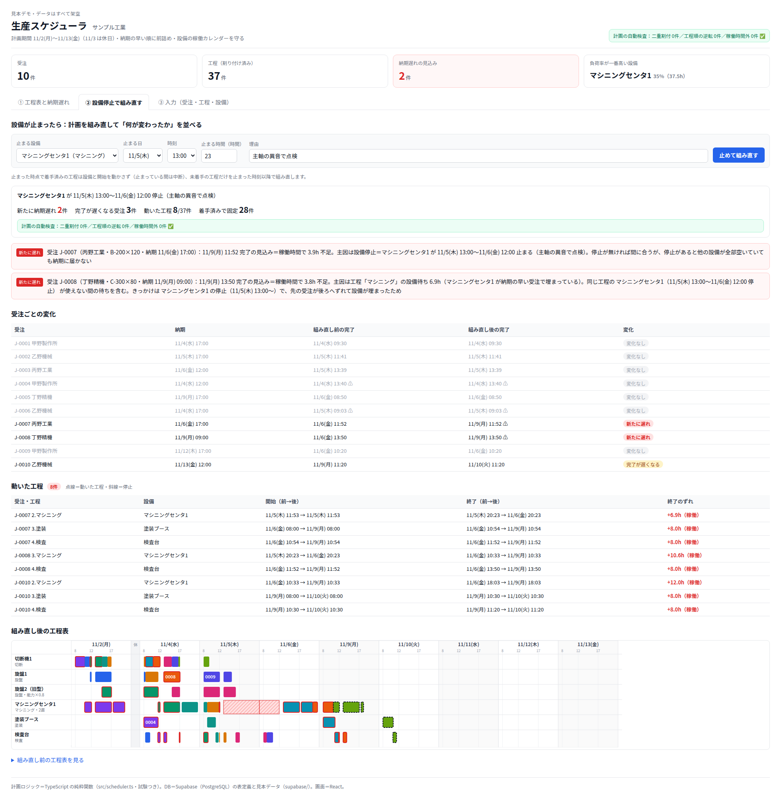

# 生産スケジューラ（見本）

受注（品番・数量・納期）・品番ごとの工程順と標準時間・設備の能力と稼働カレンダーから、設備ごとの工程表を自動で組む**見本の画面**です。

- 納期の早い順に前詰めし、休憩・夜・休日には工程を置きません
- 間に合わない受注は「どの工程で・稼働時間で何時間足りないか」を理由つきで警告します
- 設備が止まった時は、着手済みの工程は動かさずに残りを組み直し、「何がどう変わったか」を受注ごと・工程ごとに並べます

表示しているのは架空の「サンプル工業」のデータです。実際の工場のデータは入っていません。

技術: React / TypeScript（計画ロジックは試験つきの純粋関数）・Supabase（PostgreSQL）の表定義

AIフローアーキテクト
